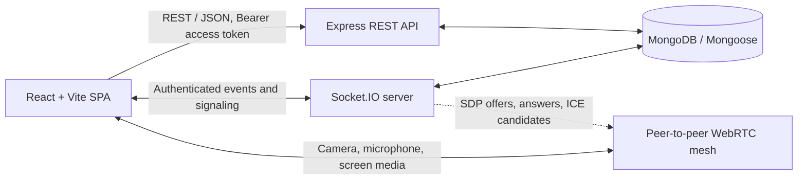

# AuraMeet

**AuraMeet is a real-time video conferencing platform** built with React, Express, MongoDB, Socket.IO, and browser WebRTC APIs. It provides meeting creation and lifecycle controls, a peer-to-peer camera/audio mesh, screen sharing, a waiting room, participant moderation, meeting chat, and host-configurable meeting settings.

AuraMeet uses **Socket.IO for authenticated real-time events and WebRTC signaling**. WebRTC carries audio and video media directly between participants in a **peer-to-peer mesh**. The current implementation does not use an SFU and does not include deployment or cloud-hosting configuration.

## 1. Project Overview

Users can register or sign in, create meetings, schedule them, start a scheduled meeting, and join a live room using its meeting code. Hosts can configure room behavior, admit or reject waiting participants, remove participants, and end the meeting. Participants can use camera and microphone controls, exchange chat messages, and share their screen when allowed by the host.

## 2. Features

- Account registration, login, logout, and session restoration.
- Meeting creation with an optional scheduled time and configurable room settings.
- Meeting states: `scheduled`, `live`, and `ended`.
- Camera and microphone access in the lobby and meeting room, with on/off controls.
- Peer-to-peer WebRTC media connections between participants.
- Optional waiting room with host admission and rejection.
- Host controls for removing participants and ending a meeting.
- Meeting chat with persisted message history for current participants.
- Screen sharing, subject to meeting settings.
- Participant list with synchronized microphone and camera status indicators.
- Responsive React single-page application interface.

## 3. Tech Stack

| Area | Technologies |
| --- | --- |
| Frontend | React 19, Vite 6, React Router, Axios |
| Backend | Node.js (ES modules), Express 5 |
| Database | MongoDB with Mongoose |
| Real-time events and signaling | Socket.IO server and client |
| Audio/video media | Browser WebRTC APIs (`RTCPeerConnection`, `getUserMedia`, `getDisplayMedia`) |
| Authentication | JWT access and refresh tokens, bcrypt password hashing, HttpOnly refresh cookie |
| UI | Bootstrap 5, Bootstrap Icons, application CSS |

## 4. System Architecture



The Express API and Socket.IO server run on the same backend HTTP server. REST handles account and meeting operations. Socket.IO coordinates meeting presence, waiting-room notifications, chat, media-state updates, screen-share metadata, and WebRTC signaling. WebRTC carries the media itself.

The media topology is a full peer mesh: each participant establishes a separate peer connection with each other participant. The project does not currently use an SFU or claim production-scale scalability.

## 5. Authentication

- Registration and login return a JWT access token and set a refresh token in an **HttpOnly cookie**.
- The frontend keeps the access token in JavaScript memory; it does not persist tokens in local or session storage.
- The refresh endpoint reads the cookie, verifies the JWT, and checks it against the single refresh token stored for the user.
- Access tokens expire after 15 minutes; refresh tokens expire after 7 days.
- Axios sends credentials for cookie-based refresh. Protected REST requests use the access token as a Bearer token.
- Socket.IO authenticates its connection using the current access token.
- Cookie `secure` and `sameSite` options vary with `NODE_ENV`.

Because browser cookies are shared by tabs on the same origin, testing different accounts simultaneously should use separate browser profiles or separate normal/incognito sessions.

## 6. Meeting Lifecycle

1. An authenticated host creates a meeting. New meetings begin in `scheduled` state.
2. The host starts the meeting, changing its state to `live`.
3. Participants join with the meeting code. The client uses the meeting REST endpoint and joins the live Socket.IO room.
4. Joining a scheduled or ended meeting is rejected. A live meeting can be ended by its host, changing its state to `ended` and closing its live room.
5. Participants can leave the meeting; hosts can end it for everyone.

## 7. Real-Time Communication

Socket.IO is used for authenticated, room-scoped coordination. It carries participant join/leave events, media-state changes, waiting-room updates, chat, screen-share status, and signaling messages. The backend relays signaling messages to their target socket; it does not relay the audio or video streams.

## 8. WebRTC Architecture

AuraMeet uses a **peer-to-peer mesh**. Each client maintains a separate `RTCPeerConnection` keyed by the remote participant’s socket ID. The hook exchanges SDP offers and answers and ICE candidates through Socket.IO. Local camera and microphone tracks are attached to each peer connection; received tracks are mapped to the corresponding remote socket for display.

The current frontend configures a STUN server. No SFU or TURN service is configured in the repository. Mesh connections require each participant to maintain a connection with every other participant, so capacity and connectivity depend on client devices and network conditions.

## 9. Waiting Room

When enabled, a non-host who requests to join a live meeting waits for host action. The host receives the waiting list when entering and receives notifications when new people arrive. The host can admit a waiting participant or reject the request. Meeting settings also include a room lock that prevents new participants from joining.

## 10. Chat

Meeting chat is delivered through Socket.IO and messages are stored in MongoDB. A participant can retrieve up to 100 recent messages from their current participation period. Messages are limited to 2,000 characters, and the backend limits a socket to 20 chat sends per 10-second window. The host can disable chat for participants.

## 11. Screen Sharing

Participants can start a browser screen capture when screen sharing is allowed (the host can share regardless of that setting). The frontend attaches the captured video using a screen transceiver on its existing peer connections. Socket.IO announces the active presenter and relays signaling; WebRTC sends the screen media to peers. The presenter also sees a local preview. This remains part of the peer mesh rather than a server-side media relay.

## 12. Participant Management

The meeting room displays its participants and camera/microphone indicators. Hosts can remove participants. A participant can leave the room, while the host can end the meeting for all participants. The server tracks live socket membership and participant records in MongoDB.

## 13. Meeting Settings

Hosts can configure these settings when creating a meeting and update them while it is live:

- `waitingRoom`: require host admission for participants.
- `lockMeeting`: prevent new participants from joining.
- `allowChat`: enable or disable participant chat.
- `allowScreenShare`: enable or disable participant screen sharing.

## 14. Project Structure

```text
AuraMeet/
├── backend/
│   └── src/
│       ├── config/          # Environment and MongoDB connection
│       ├── controllers/     # REST request handlers
│       ├── middleware/      # HTTP and Socket.IO authentication/errors
│       ├── models/          # Mongoose models
│       ├── routes/          # Express API routes
│       ├── services/        # Authentication and meeting operations
│       ├── sockets/         # Socket.IO meeting, chat, and signaling handlers
│       └── utils/           # Errors and JWT helpers
└── frontend/
    ├── src/
    │   ├── api/             # Axios APIs and Socket.IO client
    │   ├── components/      # Meeting, chat, participant, and waiting-room UI
    │   ├── context/         # Authentication and toast contexts
    │   ├── hooks/           # Authentication, Socket.IO, and WebRTC hooks
    │   ├── pages/           # Landing, auth, dashboard, and meeting pages
    │   └── utils/           # Validation and display helpers
    └── .env.example         # Vite API and Socket.IO URL examples
```

## 15. API / Socket Events Overview

All meeting REST routes require a valid access token. Authentication routes are mounted at `/api/auth`; meeting routes are mounted at `/api/meetings`.

### REST API

| Method | Path | Purpose |
| --- | --- | --- |
| `POST` | `/api/auth/register` | Register an account |
| `POST` | `/api/auth/login` | Sign in |
| `GET` | `/api/auth/me` | Get the authenticated user |
| `POST` | `/api/auth/refresh` | Exchange the refresh cookie for a new access token |
| `POST` | `/api/auth/logout` | Revoke the stored refresh token and clear its cookie |
| `POST` | `/api/meetings` | Create a meeting |
| `GET` | `/api/meetings` | List meetings hosted by the current user |
| `GET` | `/api/meetings/:meetingCode` | Get meeting details |
| `POST` | `/api/meetings/:meetingCode/join` | Record a join request or participant join |
| `POST` | `/api/meetings/:meetingCode/start` | Start a scheduled meeting |
| `POST` | `/api/meetings/:meetingCode/end` | End a live meeting (host only) |
| `POST` | `/api/meetings/:meetingCode/leave` | Leave the meeting |
| `PATCH` | `/api/meetings/:meetingCode/settings` | Update meeting settings (host only) |
| `POST` | `/api/meetings/:meetingCode/admit` | Admit a waiting participant (host only) |
| `GET` | `/api/meetings/:meetingCode/participants` | Get meeting participants |

### Socket.IO events

The current server handles these client events: `meeting:join`, `meeting:leave`, `media:state`, `host:admit`, `host:reject`, `host:remove`, `meeting:lock`, `screenshare:start`, `screenshare:stop`, `webrtc:offer`, `webrtc:answer`, `webrtc:ice-candidate`, `chat:send`, and `chat:history`.

Server notifications include `meeting:participants`, `meeting:started`, `meeting:ended`, `meeting:settings-updated`, `meeting:error`, `participant:joined`, `participant:left`, `participant:removed`, `participant:media-state`, `waiting:status`, `waiting:list`, `waiting:participant`, `waiting:admitted`, `waiting:rejected`, `waiting:left`, `screenshare:started`, `screenshare:stopped`, `chat:history`, `chat:message`, and `chat:error`.

## 16. Setup and Installation

### Prerequisites

- Node.js and npm.
- A MongoDB instance reachable from the backend.
- A browser that supports camera/microphone access and WebRTC. Screen sharing requires browser support for `getDisplayMedia`.

Install dependencies in each application directory:

```sh
cd backend
npm install

cd ../frontend
npm install
```

Create `backend/.env` with the variables listed below. The repository does not include a backend environment example file. The frontend does include `frontend/.env.example`; copy it to `frontend/.env` if you need to override the local URLs.

PowerShell copy command:

```powershell
Copy-Item .env.example .env
```

Run that command from the `frontend` directory.

## 17. Environment Variables

Backend variables are read in `backend/src/config/env.js`:

| Variable | Purpose | Local default / example |
| --- | --- | --- |
| `PORT` | Express and Socket.IO HTTP port | `8000` |
| `MONGO_URI` | MongoDB connection URI | For local MongoDB, e.g. `mongodb://127.0.0.1:27017/aurameet` |
| `JWT_ACCESS_SECRET` | Secret used to sign access tokens | Set a strong private value |
| `JWT_REFRESH_SECRET` | Secret used to sign refresh tokens | Set a different strong private value |
| `NODE_ENV` | Runtime mode and refresh-cookie options | `development` |
| `CLIENT_URL` | Allowed frontend origin for CORS/Socket.IO | `http://localhost:5173` |

The provided `frontend/.env.example` defines:

| Variable | Purpose | Example |
| --- | --- | --- |
| `VITE_API_URL` | Backend API base URL | `http://localhost:8000/api` |
| `VITE_SOCKET_URL` | Backend Socket.IO origin | `http://localhost:8000` |

Do not commit real credentials or secret values. `localhost:5173` and `127.0.0.1:5173` are allowed by the backend CORS configuration; `CLIENT_URL` supplies the configured frontend origin.

## 18. Running the Project

Start MongoDB before starting the backend. Use two terminals from the project root.

Backend terminal:

```sh
cd backend
npm start
```

Frontend terminal:

```sh
cd frontend
npm run dev
```

The backend package also defines `npm run dev` as `nodemon src/app.js`, but `nodemon` is not declared in the backend package dependencies. Use it only if `nodemon` is already available in your environment. The Vite dev server uses the frontend package's `dev` script.

## 19. Testing

The frontend provides a production build check:

```sh
cd frontend
npm run build
```

There is no configured backend build or automated test suite. The backend `test` script is currently a placeholder that exits with an error. A basic backend JavaScript syntax check can be run from `backend`:

```sh
node --check src/app.js
```

For full backend syntax validation, run `node --check` against each JavaScript file under `backend/src`. Functional testing of camera, microphone, screen sharing, and multi-participant mesh behavior requires supported browsers and a live meeting setup.

## 20. Future Improvements

- Add automated unit, API integration, and multi-participant WebRTC tests.
- Add TURN configuration for networks where direct peer connectivity is unavailable.
- Evaluate an SFU architecture if room size and bandwidth requirements grow.
- Add deployment, monitoring, and production operations documentation when those environments are established.
- Add CI checks for frontend builds and backend validation.

